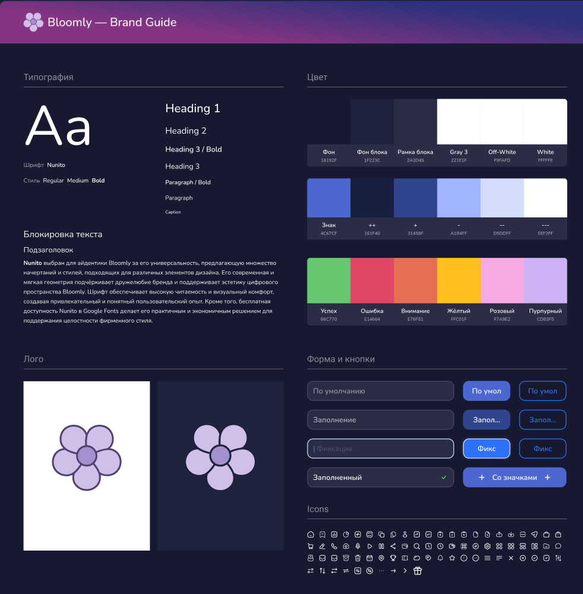

<div align="center">

# 🌸 Bloomly Mobile

**Мобильное приложение соцсети Bloomly**


</div>

---

## О проекте

Bloomly — соцсеть, у которой есть веб-версия и бэкенд (отдельный репозиторий). Этот репозиторий — мобильный клиент на Expo.

> **Статус:** каркас. Настроены навигация, шрифт, тёмная тема и сборка; экраны будут добавляться поверх.

## Стек

| Область | Технологии |
|---|---|
| Фреймворк | [Expo](https://expo.dev) 58, React Native 0.88, React 19 |
| Навигация | [Expo Router](https://docs.expo.dev/router/introduction/) (файловая маршрутизация) |
| Стили | [NativeWind](https://www.nativewind.dev) 4 + Tailwind CSS 3 |
| Данные | TanStack Query, Axios |
| Состояние | Zustand |
| Хранилище | AsyncStorage, Expo SecureStore (токены) |
| Анимации | Reanimated 4, Worklets |
| Графика | expo-image, react-native-svg |
| Язык | TypeScript |

## Быстрый старт

Нужны Node.js и [Expo Go](https://expo.dev/go) на телефоне либо эмулятор Android / симулятор iOS.

```bash
npm install
npm start          # dev-сервер, QR-код для Expo Go
```

| Команда | Что делает |
|---|---|
| `npm start` | Запускает dev-сервер Expo |
| `npm run android` | Запуск на Android |
| `npm run ios` | Запуск на iOS (только macOS) |
| `npm run typecheck` | Проверка типов (`tsc --noEmit`) |
| `npm run build:android` | Экспорт Android-бандла |

## Структура

```
mobile/
├── app/                 # экраны и роутинг (Expo Router)
│   ├── _layout.tsx      # корневой layout
│   └── index.tsx        # главный экран
├── docs/
│   └── brand-guide.jpg  # макет бренд-гайда
├── app.json             # конфиг Expo (имя, схема, иконки, плагины)
├── global.css           # директивы Tailwind для NativeWind
├── tailwind.config.js   # токены дизайна
├── babel.config.js
├── metro.config.js
└── tsconfig.json
```

## Дизайн

Приложение тёмное (`userInterfaceStyle: dark`), шрифт — **Nunito**. Цвета вне палитры гайда не вводятся. Токены лежат в [tailwind.config.js](tailwind.config.js) и совпадают с `brand-guide.md` основного репозитория.

<p align="center">
  
</p>

### Цвет

Нейтральные:

| Роль | HEX | Класс |
|---|---|---|
| Фон | `#16192F` | `bg-brand-bg` |
| Фон блока | `#1F223C` | `bg-brand-card` |
| Рамка блока | `#2A2D45` | `border-brand-border` |
| Приглушённый | `#3A4060` | `brand-muted` |
| Off-White | `#F9FAFD` | `text-brand-offwhite` |

Акцент («Знак» и ступени):

| Ступень | HEX | Класс |
|---|---|---|
| Знак | `#4C67CF` | `brand-accent` |
| ++ | `#161F40` | `brand-accent-plus-plus` |
| + | `#31458F` | `brand-accent-plus` |
| − | `#A1B4FF` | `brand-accent-minus` |
| −− | `#D5DDFF` | `brand-accent-minus-minus` |
| −−− | `#EEF2FF` | `brand-accent-minus-minus-minus` |

Статусные и декоративные:

| Роль | HEX | Класс |
|---|---|---|
| Успех | `#66C770` | `brand-success` |
| Ошибка | `#E14664` | `brand-error` |
| Внимание | `#E76F51` | `brand-warning` |
| Жёлтый | `#FFC01F` | `brand-yellow` |
| Розовый | `#F7A9E2` | `brand-pink` |
| Пурпурный | `#CD83F5` | `brand-purple` |

### Типографика

Nunito подключён через `@expo-google-fonts/nunito` в [app/_layout.tsx](app/_layout.tsx). В React Native начертание задаётся семейством, поэтому вместо `font-bold` используются:

| Класс | Начертание |
|---|---|
| `font-nunito` | Regular |
| `font-nunito-medium` | Medium |
| `font-nunito-bold` | Bold |

### Кнопки и поля

| Элемент | По умолчанию | Заполнение | Фиксация (фокус) |
|---|---|---|---|
| Кнопка с заливкой | `brand-accent` | `brand-accent-plus` | яркий синий со свечением |
| Кнопка-контур | синяя рамка и текст | то же, приглушённее | яркая рамка |
| Поле | тёмная заливка, приглушённый плейсхолдер | введённый текст | светлая рамка, курсор |

Заполненное поле показывает галочку `brand-success` справа. Иконки — Phosphor, начертание Bold, активное состояние — Fill.

## Идентификаторы приложения

- Схема deep link: `bloomly://`
- iOS bundle id и Android package: `app.bloomly.mobile`

## Связанные проекты

- **Веб-версия и бэкенд** (Vue 3, Fastify, Prisma, PostgreSQL) — отдельный репозиторий Bloomly.
